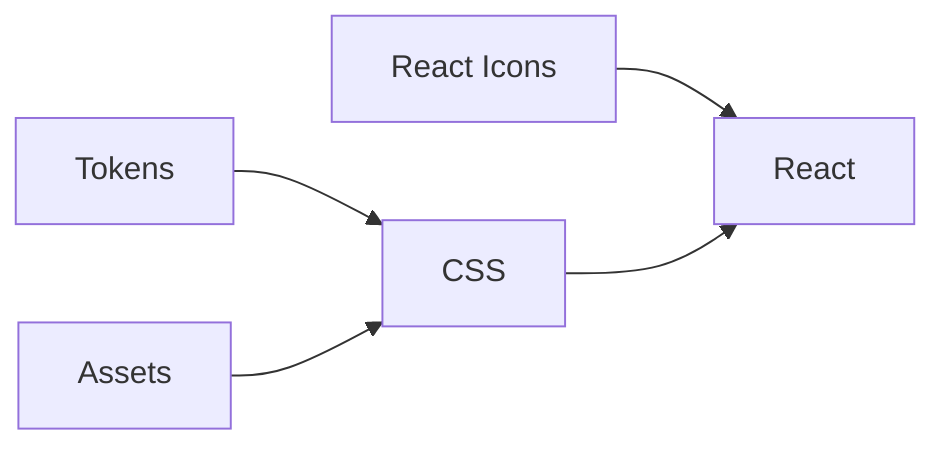

<!-- @license CC0-1.0 -->

# Publishing

We use a [Release Please GitHub Action](https://github.com/googleapis/release-please-action) to create changelogs and release PRs for all our packages.
When the release PR is merged, the “Publish packages” workflow (specifically the `pnpm -r publish` step in `.github/workflows/publish-packages.yml`) publishes the new release to npm, after Release Please reports `releases_created == 'true'`. Release Please itself creates the release PR and the GitHub release, but does not publish to npm.
A separate “Deploy production Storybook” workflow keeps our main Storybook environment up to date with `main`.

The [maintainers](./maintainers.md) can release new versions of our packages.
If you want to have rights to publish as well, contact one of the maintainers.

The “Publish packages” workflow uses [npm trusted publishing](https://docs.npmjs.com/trusted-publishers) (OIDC), so individual maintainers don’t need personal npm credentials.

## Conventional commits

### Choosing a commit type

To know whether a release is major, minor or patch and to generate changelogs automatically, we use the [conventional commits spec](https://www.conventionalcommits.org/en/v1.0.0/).
The titles of our PRs specify whether a change is:

- a `chore` which doesn’t trigger a release
- a `fix` resulting in a patch release,
- a new feature (`feat`), a minor release, or
- a breaking change (append an `!`), a major release.

Use the `chore` type for changes with no consumer-visible impact: development dependencies, configuration, or documentation that isn’t about a component.
Use the `fix` type for changes that should reach consumers via a patch release: refactors, regular dependency updates, or updates to documentation about components.

The PR title also describes the change in a clear, human-friendly way.
This PR title becomes the description of a commit when we squash merge a feature branch PR into `develop`.
These commit descriptions are eventually used to determine the release type and generate entries into our changelogs.

For example, a PR specifies that it’s introducing a breaking change and changes code in both the `css` and `react` packages.
This will cause a major version bump in both packages on release and add its description to the changelogs of both packages.

### Adding a scope

A scope tells the reader of a changelog which part of the design system changed.
It becomes a prefix of the entry, and entries sort alphabetically, so a consistent scope groups the history of a component:

```text
fix(Avatar): Correct the aspect ratio for the image
```

That entry reads “**Avatar**: Correct the aspect ratio for the image.”
There’s no need to repeat the scope in the rest of the title.

We recommend the conventions below.
The ‘Check PR title’ workflow validates the type of a title, never its scope.

#### Choosing a scope

Take the first row that fits the change:

| The change concerns                          | Scope                            | Example                               |
| -------------------------------------------- | -------------------------------- | ------------------------------------- |
| 1 component                                  | Its name                         | `fix(Avatar)`                         |
| 2 to 5 components                            | Their names, separated by commas | `fix(Ordered List, Unordered List)`   |
| A package, but no component in particular    | The name of the package          | `chore(Storybook)`                    |
| Documentation that isn’t about a component   | `docs`                           | `chore(docs)`                         |
| A dependency                                 | `deps` or `deps-dev`             | `chore(deps)`                         |
| A workflow                                   | `ci`                             | `chore(ci)`                           |
| The configuration of a tool                  | The name of the tool             | `chore(ESLint)`                       |
| More than 5 components, or none of the above | None                             | `feat: Add a skip link to every page` |

#### Spelling a scope

Write a component as its documentation page names it, in title case and with spaces: `Description List`, not `DescriptionList`.

Write a package as we write it in prose elsewhere in this file: `Tokens`, `CSS`, `React`, `Assets`, `React Icons`, and `Storybook`.

Keep our own topics lowercase, such as `docs`, `deps`, `ci`, and `tests`.
Give a third-party tool the spelling it uses itself, such as `ESLint`, `Stylelint`, and `TypeScript`.

### Writing the subject

The subject is what a reader of the changelog sees, so write it for someone who didn’t read the code.

- Write in English, without jargon.
- Start with a capital letter and use the imperative mood, as in ‘Correct the aspect ratio for the image’.
- Leave out the full stop at the end.
- Describe the outcome, not the mechanics: ‘Show a placeholder background while the image loads’ tells more than ‘Add a CSS background-color declaration’.
- Keep it to one line, and as short as you can: aim for 80 characters.

```text
fix(Avatar): Correct the aspect ratio for the image
feat(Modal Dialog): Add Modal Dialog component and repurpose Dialog for short messages
fix(Ordered List, Unordered List): Only style a list that is directly nested in a list item
feat(Progress List)!: Make collapsing and expanding steps optional
chore(docs): Clarify what the Baseline linter cannot check in token values
chore(deps): Install minor updates
```

## How to create a release

### Release checklist

Until the merge-back is automated, agree a temporary pause on merges and pushes to `develop` between promotion and merge-back.

1. Prepare: agree the publication date and release scope, identify the previous `chore: release main` commit, and wait for the checks on `develop` to pass.
2. Write and merge the [release notes](./release-notes.md) into `develop` before promotion, using the planned date and expected package versions.
3. [Recount the introduction figures](./introduction-statistics.md) and merge any corrections into `develop`.
4. [Fast-forward `main`](#merge-into-the-main-branch) to the agreed `develop` commit.
5. [Review the release PR](#review-the-release-pr).
6. [Approve and merge the release PR](#approve-and-merge-the-release-pr).
7. Verify every expected package version on npm, its tag and notes in [GitHub releases](https://github.com/Amsterdam/design-system/releases), and the release notes and changed components in [production Storybook](https://designsystem.amsterdam/).
   Check that the publishing and production deployment workflows succeeded for the release commit.
8. [Merge back into `develop`](#merge-back-into-develop) and verify the remote branches.
9. [Announce the release](#announce-the-release) after those checks pass.

### Merge into the main branch

Locally merge the latest version of `develop` into `main` using a fast-forward merge, and push to the remote:

```sh
git checkout main
git fetch origin
git pull --ff-only origin main
git merge --ff-only origin/develop
git push origin main
```

After a successful build on `main`, the “Publish packages” workflow opens or updates the release PR.

### Review the release PR

Check the proposed versions and changelogs for every affected package against the release scope and prepared release notes.
A commit might only be a breaking change for one package, but it will be marked as breaking for all affected packages.

Mirror changelog edits into the PR description, which becomes the GitHub release notes.

Check [peer dependencies](#dependencies-between-packages), especially when only Tokens or Assets change.

**Note**: Add a ‘Deprecations’ section to the changelog of each package that deprecates something in this release.
List the old names, their replacements, and the date from which we may remove them.
Use the [deprecations report](#find-deprecations) as a starting point.

#### Moving removal dates

Our [release policy](../storybook/src/docs/guidelines/release-policy.docs.mdx) keeps deprecated features available for at least six months after we publish their deprecation.
A pull request sets its removal date when it is merged into `develop`, so a later release can leave less than six months.
Move every date that falls short to a date at least six months after publication, and give the deprecations in one release the same date.

This is the one exception to the rule that a release PR changes no source files.
Change the date everywhere it appears, on the release PR branch: JSDoc, `$deprecated` in tokens, comments in CSS, `deprecations.mjs`, and the Storybook docs.
Don’t push to `main` until the release PR is merged: Release Please then rebuilds the release PR branch and drops these changes.
An update also replaces the PR description, so keep a local copy of manual edits until merging.

### Approve and merge the release PR

After another developer approves the PR, select **Squash and merge**, keeping the squash commit title `chore: release main (#…)`.
Wait for the required checks, especially when [removal dates changed in source](#moving-removal-dates).

### Merge back into develop

Until the merge-back is automated, ask an admin to fast-forward `develop` to the release commit on `main` and push it.
Admins can bypass the ruleset, which risks unreviewed changes reaching `develop`.
Do not open a merge-back PR: `develop` only permits squash merges, which creates a different commit and breaks the ancestry needed for the next promotion.

```sh
git fetch origin
git rev-list --left-right --count origin/develop...origin/main
```

Expect `0 0`.

#### Recover from an accidental push to develop

If an unreviewed commit was pushed directly, tell the team and preserve it on a separate branch.
Ask an admin to restore the last reviewed commit with `git push --force-with-lease=develop:<observed-tip> origin <last-reviewed-commit>:develop`, using the remote tip the team inspected as the lease.
Bring the change in again through a normal, reviewed PR.

### Find deprecations

Compare the previous `chore: release main` commit with `HEAD`, or use `--to <ref>` for another endpoint.
That commit covers every package, including those it didn’t release.

```sh
pnpm run deprecations <previous-release-commit> --publication-date <YYYY-MM-DD>
```

It lists new deprecations, flags new dates less than six months after publication, and reports expired dates.
Check undated CSS markers against their token or component annotations, and check `StatusBadge` dates in [Storybook docs](../storybook/src) and the [icon registry](../packages-proprietary/react-icons/deprecations.mjs) by hand: neither is scanned.

### Announce the release

Use the highest version bump among the published packages to choose the Slack audience; the design system has no single version number.
Patch-only releases have no routine announcement.

| Release or change                                                                                                                        | Channel                                                                                                                                                      | Audience                                      |
| ---------------------------------------------------------------------------------------------------------------------------------------- | ------------------------------------------------------------------------------------------------------------------------------------------------------------ | --------------------------------------------- |
| Minor                                                                                                                                    | Slack `#gilde-frontend`                                                                                                                                      | Frontend developers                           |
| Major                                                                                                                                    | Slack `#vakgroep-softwareontwikkeling`                                                                                                                       | Everyone in the Vakgroep Softwareontwikkeling |
| Minor and major                                                                                                                          | [MS Teams, Amsterdam Design System, General](https://teams.microsoft.com/l/channel/19%3AfYKS_RD2n1q4UhguA9jwEJk0A_VjYPO4TiLQjYlG_bo1%40thread.tacv2/General) | Interested followers and stakeholders         |
| New component or structural change, such as a rename, with an [NL Design System counterpart](https://www.nldesignsystem.nl/componenten/) | Matching [NL Design System discussion](https://github.com/orgs/nl-design-system/discussions/)                                                                | NL Design System maintainers                  |

Use the [announcement tone](./writing.md#release-announcements) and link the release notes in Slack and Teams.
For NL Design System, thank the community and ask maintainers to add our community implementation or update its name and links.
Link the component's documentation, source code at the release tag, and npm package.

Use the [release skill](../.github/skills/release/SKILL.md) for drafts and matching threads.
Keep drafts private, outside public issues, PRs, Actions logs, and artefacts; agents post nothing.

### Gotchas

#### Don’t change the PR title

Keep the generated `chore: release main` title: Release Please parses it when recognising the merged release PR.

#### Remove stale release labels

Release Please uses labels to determine the status of a release.
A release PR gets the label `autorelease: pending` or `autorelease: triggered`.
When running the action again, the PR with those labels gets released, and the labels should be removed.

However, due to GitHub API failures, it’s possible that the label was not removed correctly upon a previous release and Release Please thinks that the previous release is still pending.
Release Please will not create a new release PR if it thinks there is a pending release.

To fix this, check whether any closed PRs still have the `autorelease: pending` or `autorelease: triggered` labels, and remove them.

[See the Release Please docs for more information](https://github.com/googleapis/release-please?tab=readme-ov-file#release-please-bot-does-not-create-a-release-pr-why).

## What each package publishes

Every published package declares a `files` field, the allowlist of what npm puts in the tarball.
Without one, a package publishes whatever happens to be tracked in git inside its directory, plus the gitignored `dist/` that CI builds.
Nothing then records what a package is meant to contain, so its contents drift silently whenever someone adds a file.

We declared these explicitly in [pull request 2821](https://github.com/Amsterdam/design-system/pull/2821), which cut the Tokens tarball from 113 files to 15 by dropping the token sources, the Style Dictionary transforms and its build tooling.
CSS deliberately keeps `src/` next to `dist/`: our guidelines document importing breakpoint variables from `src/common/breakpoint.scss`, which have to be Sass variables because custom properties can’t be used in media queries.
Measure with `npm pack --dry-run` on a clean build before changing a `files` field, and check that every documented entry point still resolves.

### Linting the package manifests

`pnpm run lint:package-json` checks every `package.json` against `.npmpackagejsonlintrc.json`.
An entry in its `overrides` block switches `require-files` on for the published packages only, since the private manifests publish no tarball whose contents need allowlisting.

Keep that single config file at the root.
`npmPkgJsonLint` loads the **nearest** config file and never merges it with the ones above it, so a config in a subdirectory replaces the root rule set instead of extending it.
A second config in `packages-proprietary` did precisely that, from the first commit of this repository until July 2026: Tokens, Assets and React Icons were checked against only the rules it listed, never the root ones, and the build stayed green the whole time.
Rules that apply to only some packages belong in the `overrides` block of the root config, where a path pattern selects them.

Verify any change to these rules by deleting a required field from a `package.json` and confirming that the rule fires.
A lint that passes proves nothing on its own, because a shadowed rule is silently absent rather than failing.

## Dependencies between packages

We’ve established dependencies between our packages to avoid version mismatches.
For instance, our React package requires a specific version of our CSS package.

Here’s the dependency structure:



Managing these dependencies requires extra attention when publishing.
We use [PNPM’s workspace feature](https://pnpm.io/workspaces#publishing-workspace-packages) to define dependencies between our packages.
When we publish CSS and React, the latest specific versions of their dependencies get pinned: Tokens and Assets for CSS, and CSS and React Icons for React.

This setup works well when we update both CSS and React in a release.
However, issues arise if a release only updates Tokens and Assets without changes to CSS or React.
The latest version of CSS then depends on an older version of Tokens.

**Step-by-step example for dependency updates:**

1. Release a new version of Tokens or Assets only.
2. In the CSS package, update the dependency for Tokens or Assets from `"workspace:*"` to the new version number (e.g., `"x.y.z"`).
3. Run `pnpm i` to update the lockfile.
4. Release a new version of the CSS package, with the correct peer dependency.
5. (Optional) Restore the dynamic dependency (`workspace:*`) in the CSS package and run `pnpm i` again.
6. If needed, update and release React to depend on the new CSS version.

Although infrequent, this scenario might occur in the future.
